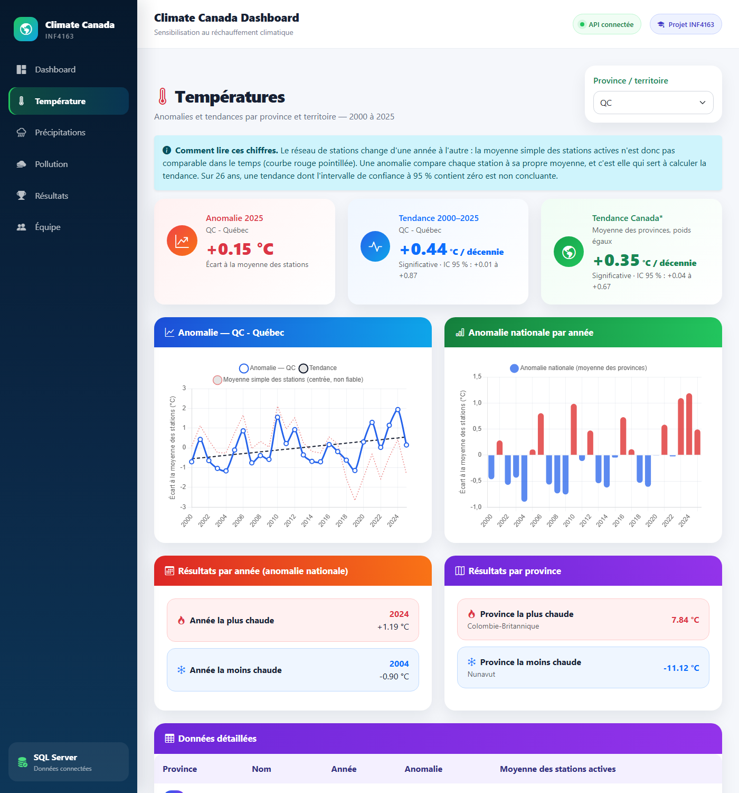
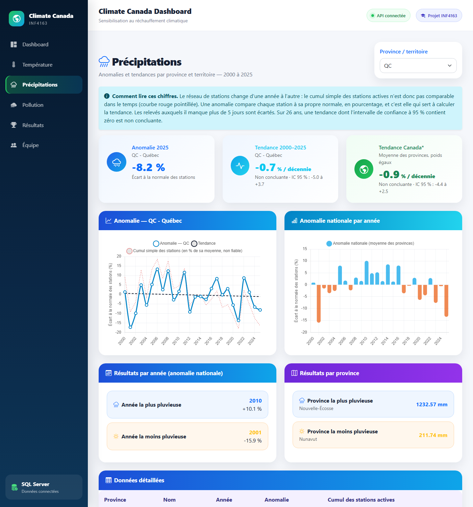
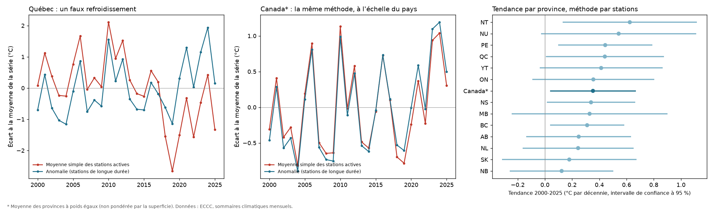
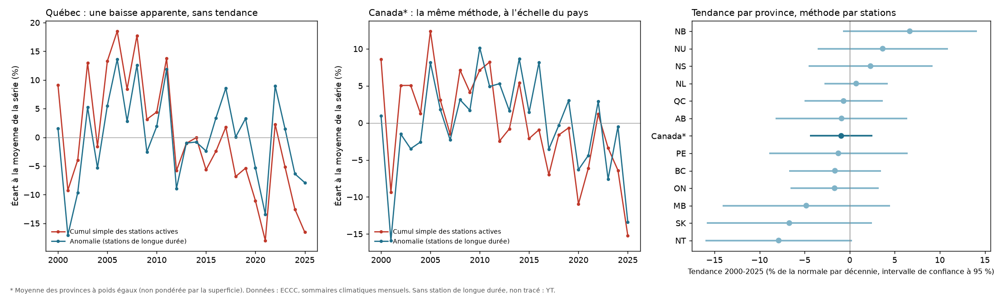
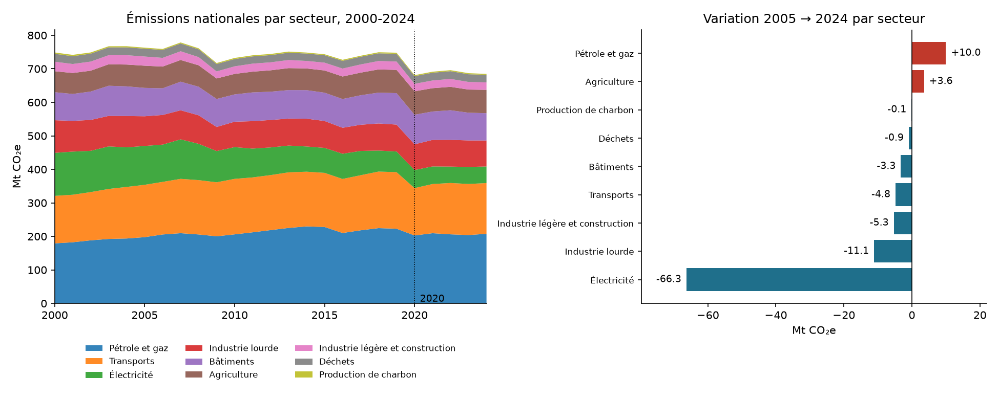

# Climate Canada Dashboard

[](https://github.com/Ulrich120/Projet_INF4163_Climate_Canada/actions/workflows/ci.yml)

Projet réalisé pour le cours **INF4163 — Techniques de bases de données** à l'UQO. L'idée de départ : prendre des données climatiques publiques du Canada (température, précipitations, émissions de GES) et construire une petite application complète autour — base de données, API, interface web, et maintenant un tableau de bord Power BI.

Le but n'était pas juste de "faire joli" avec des graphiques, mais de manipuler un vrai pipeline de données : aller chercher les fichiers bruts, les nettoyer, les charger dans SQL Server, écrire des procédures stockées pour en tirer des analyses, puis exposer tout ça via une API et un frontend.

**Démo en ligne : [projet-inf-4163-climate-canada.vercel.app](https://projet-inf-4163-climate-canada.vercel.app)** (interface sur Vercel, API sur Render, données en lecture seule). L'API est sur l'offre gratuite de Render : elle se met en veille après quelques minutes d'inactivité, donc la première page peut mettre environ une minute à répondre.

## En bref

**Les données.** 4 056 fichiers mensuels d'Environnement et Changement climatique Canada (13 provinces et territoires, 2000-2025), soit 434 723 relevés de 3 175 stations, chargés dans SQL Server, servis par une API et affichés dans une interface React (et dans Power BI).

**Ce que j'en retire** (la partie qui m'a le plus appris) :

- **La moyenne des stations ment.** Le réseau passe d'environ 1 780 stations actives en 2000 à environ 1 000 en 2025. La moyenne simple fait « refroidir » le Québec (−0,74 °C par décennie) alors que, station par station, il se réchauffe (+0,44).
- **Pire pour les précipitations.** La somme simple affiche une baisse nationale « significative » (−38 mm par décennie). Par stations, il n'y a rien de détectable : −0,9 % par décennie, intervalle de −4,4 à +2,5.
- **Une rupture de qualité en 2008.** La part de relevés auxquels il manque plus de 5 jours de mesure passe de 4 % à 17 %.
- **Les résultats portent leur incertitude.** Canada : +0,35 °C par décennie, intervalle de confiance à 95 % de 0,04 à 0,67. Sur 13 provinces, seules 5 ont une tendance dont l'intervalle exclut zéro.

La méthode est validée sur des réseaux synthétiques dont on connaît la bonne réponse, et ses limites sont écrites dans [`Data/README.md`](Data/README.md).

| Températures | Précipitations |
|---|---|
|  |  |

## Ce que ça fait

L'application permet d'explorer, province par province, l'évolution de trois choses entre 2000 et 2025 :

- la **température** moyenne annuelle,
- les **précipitations** cumulées,
- les **émissions de GES** (en Mt CO₂e).

Pour chaque thème, il y a des graphiques, une carte du Canada, et une page "résultats" qui affiche ce que sortent nos procédures stockées (année/province la plus chaude, la plus pluvieuse, etc.).

> Petite note honnête sur les données : les chiffres officiels de GES par province pour 2025 ne sont pas encore publiés. Ces cellules restent à `NULL` plutôt que d'être extrapolées. Même logique pour la température et les précipitations : une année n'est calculée que si les 12 mois sont disponibles, sinon la valeur reste vide (voir [`Data/README.md`](Data/README.md) pour la méthode et ses limites).

*La version d'origine du projet (2023-2025, telle que remise pour le cours) est conservée sur le tag `v1-remise-inf4163`.*

## Architecture

Rien de très exotique, c'est le classique base de données → API → frontend :

```
Data brutes (ECCC)
      │
      ▼
   ETL (Python)
      │
      ▼
 SQL Server (3 bases : TemperatureDB, PrecipitationDB, PollutionDB)
      │
      ▼
  FastAPI (backend)
      │
      ▼
   React (frontend)
      │
      ▼
   Power BI (analyse / tableau de bord)
```

Le frontend ne touche jamais directement aux données : tout passe par l'API, qui elle-même interroge SQL Server via pyodbc.

## Les trois bases de données

On a choisi de séparer les trois thèmes en bases distinctes plutôt que de tout mettre dans une seule — plus proche de ce qu'on ferait si chaque domaine (météo, environnement) était géré par une équipe différente.

**TemperatureDB** — température moyenne par province/territoire et par mois, avec l'agrégation annuelle correspondante.

**PrecipitationDB** — précipitations cumulées, même logique de granularité mensuelle → annuelle.

**PollutionDB** — émissions de GES en Mt CO₂e, avec les années non publiées à `NULL` pour les raisons expliquées plus haut.

Chaque base a ses propres procédures stockées (`Database/Procedures/`) pour sortir l'année/la province la plus ou la moins extrême, et des déclencheurs (`Database/Triggers/`) qui bloquent l'insertion de valeurs aberrantes (température hors de -100/70 °C, précipitation négative, émission négative).

```sql
EXEC dbo.sp_AnneePlusMoinsChaude;
EXEC dbo.sp_ProvincePlusMoinsChaude;

EXEC dbo.sp_AnneePlusMoinsPluvieuse;
EXEC dbo.sp_ProvincePlusMoinsPluvieuse;

EXEC dbo.sp_AnneePlusMoinsPolluee;
EXEC dbo.sp_ProvincePlusMoinsPolluee;
```

## Le pipeline ETL

Les scripts dans `ETL/` suivent à peu près ce chemin pour chaque thème : télécharger les fichiers sources, les nettoyer (encodages inconsistants, virgules décimales à la française), calculer les agrégats mensuels puis annuels, valider que rien ne manque, et enfin générer les scripts SQL d'insertion.

C'est volontairement découpé en petits scripts plutôt qu'un seul gros programme — plus facile à relancer un morceau seul quand une source change de format en cours de route (ce qui est arrivé plus d'une fois avec les fichiers d'Environnement Canada).

## Ce que montrent les données

Premier constat, avant tout résultat climatique : **la moyenne simple des stations ne permet pas de mesurer une tendance**. Le réseau d'ECCC passe d'environ 1 780 stations actives en 2000 à environ 1 000 en 2025, si bien que la moyenne annuelle du Québec « refroidit » de 0,74 °C par décennie alors que le même réseau, suivi station par station, se réchauffe.



En comparant chaque station à sa propre moyenne (`ETL/station_anomalies.py`) :

- les 13 provinces et territoires se réchauffent, de +0,12 à +0,62 °C par décennie ;
- pour le Canada (provinces à poids égaux) : **+0,35 °C par décennie, intervalle de confiance à 95 % de 0,04 à 0,67** ;
- l'incertitude reste large : sur 26 ans, seules 5 provinces sur 13 ont un intervalle qui exclut zéro.

Même constat pour les précipitations, en plus net : la somme simple des stations actives affiche une baisse nationale « significative » (−38 mm par décennie, de 792 mm en 2000 à 618 mm en 2025), alors que par stations **il n'y a aucune tendance détectable** (−0,9 % de la normale par décennie, intervalle de −4,4 à +2,5). Les relevés avec plus de 5 jours manquants sont écartés, leur part passant de 4 % à 17 % en 2008.



Les pages Températures et Précipitations de l'interface affichent ces anomalies et ces tendances, avec leur intervalle de confiance, plutôt que la moyenne simple. Le Yukon n'a pas de station de longue durée pour les précipitations : aucune tendance n'est calculée.

Côté émissions de GES, le total national baisse de 10 % depuis 2005 (763,0 → 684,7 Mt CO₂e), mais **85 % de cette baisse vient du seul secteur de l'électricité** : sans lui, les émissions ne reculent que de 1,9 %, et le pétrole et le gaz progressent de 5 %.



La méthode est validée sur un réseau synthétique dont on connaît la bonne réponse (tests dans `tests/etl/`). Méthode complète et limites : [`Data/README.md`](Data/README.md). La lecture complète des résultats, avec ce qu'ils permettent et ne permettent pas d'affirmer, est dans [`docs/analyse.md`](docs/analyse.md).

## Power BI

En plus du dashboard React, `PowerBI/` explique comment brancher un rapport Power BI directement sur les trois bases SQL Server, pour une analyse plus libre que ce que permet l'interface web (croisements, filtres dynamiques, export). Voir [`PowerBI/README.md`](PowerBI/README.md) pour la marche à suivre — en résumé, Power BI Desktop se connecte en direct aux bases via le même driver ODBC que le backend.

## Stack technique

| Techno | Rôle |
|---|---|
| SQL Server / T-SQL | Stockage, procédures stockées, déclencheurs |
| Python + pandas | ETL (extraction, nettoyage, agrégation) |
| pyodbc | Connexion Python ↔ SQL Server |
| FastAPI + Uvicorn | API REST |
| React + Vite | Interface web |
| Chart.js | Graphiques |
| Power BI Desktop | Tableau de bord analytique |
| Docker Compose | SQL Server, API et interface en une commande |
| SQLite | Mode démonstration en ligne (lecture seule) |
| Render, Vercel | Hébergement de la démo (API, interface) |
| Bootstrap | Mise en page rapide du frontend |

## Structure du dépôt

```
Projet_INF4163/
├── Data/                 données brutes (GES) et agrégats annuels (CSV)
├── Database/             création des bases, données, procédures, déclencheurs, vues, setup.ps1
├── tests/                tests pytest (ETL et API)
├── docker/ + docker-compose.yml   démarrage complet en une commande
├── deploy/ + render.yaml          démo en ligne (image Render, comparaison SQL Server / SQLite)
├── ETL/                  scripts Python du pipeline
├── PowerBI/              guide de connexion et mesures DAX
├── Website/
│   ├── backend/          API FastAPI
│   └── frontend/         application React
├── Rapport/              rapport et annexes du cours
└── Presentation/         support de présentation
```

## Essayer le projet en une commande (Docker)

Pas besoin d'installer SQL Server : un Docker Compose lance la base (SQL Server dans un conteneur), l'API et l'interface.

```bash
cp .env.example .env          # voir la note sur les licences ci-dessous
docker compose up --build
```

Puis ouvrir **http://localhost:8080**. Le premier démarrage télécharge les images (SQL Server fait environ 1,5 Go) et crée les trois bases à partir de `Database/` ; les suivants sont immédiats, les données restant dans un volume Docker. `docker compose down` arrête tout (ajouter `-v` pour effacer aussi les données).

- **Licences Microsoft.** `.env.example` contient `ACCEPT_EULA=Y` : en copiant ce fichier en `.env`, tu acceptes le [contrat de licence de SQL Server](https://go.microsoft.com/fwlink/?linkid=857698) (édition Express) et celui du pilote ODBC installé dans l'image de l'API. Sans cette variable, `docker compose` refuse de démarrer.
- **Mot de passe.** `MSSQL_SA_PASSWORD` est une valeur de démonstration. Le port de la base n'est ouvert que sur ta machine (`127.0.0.1:14333`, par exemple pour SSMS ou Power BI) et ne l'est pas du tout vers l'extérieur.
- **Ports.** `WEB_PORT` et `DB_PORT` dans `.env` changent les ports 8080 et 14333 si besoin.
- **Vérification.** La CI GitHub lance ce même Compose à chaque push et vérifie que l'application répond avec les données.

## Déployer en ligne (Render + Vercel)

L'interface se déploie sur **Vercel** et l'API sur **Render**. SQL Server, lui, ne s'héberge pas gratuitement : Render n'en propose pas (seulement Postgres, dont l'offre gratuite expire au bout de 30 jours) et son image demande au moins 2 Go de mémoire. La démo en ligne tourne donc en **mode démonstration** : l'API lit trois petites bases SQLite en lecture seule, construites par `ETL/build_demo_db.py` à partir des mêmes CSV. L'interface l'indique (« Démo en ligne : données SQLite en lecture seule »), et la CI vérifie à chaque push que les 10 routes de l'API renvoient exactement les mêmes réponses que la version SQL Server (`deploy/compare_backends.py`).

1. **API sur Render.** Dans [le tableau de bord Render](https://dashboard.render.com) : *New* → *Blueprint* → choisir ce dépôt. Render lit `render.yaml` (service Docker, offre gratuite) et demande `CORS_ORIGINS` : mettre l'adresse Vercel si tu la connais déjà, sinon une valeur provisoire. Une fois déployé, ouvrir `https://<ton-service>.onrender.com/api/health` : la réponse doit contenir `"donnees":"sqlite"`.
2. **Interface sur Vercel.** *Add New* → *Project* → importer le dépôt, avec **Root Directory** `Website/frontend` (Vite est détecté tout seul) et la variable d'environnement `VITE_API_URL` = l'adresse Render, sans `/` final. `vercel.json` s'occupe de la navigation entre pages.
3. **Retour sur Render.** Dans *Environment*, régler `CORS_ORIGINS` sur l'adresse Vercel (par exemple `https://climate-canada.vercel.app`) : l'API n'accepte que les origines listées. `CORS_ORIGIN_REGEX` (facultative) autorise aussi les adresses de prévisualisation Vercel.
4. **Vérifier**, puis ajouter l'adresse de la démo en haut de ce README.

**Ce qu'il faut savoir.** Sur l'offre gratuite de Render, le service s'endort après 15 minutes sans visite et met environ une minute à se réveiller : l'interface l'explique pendant l'attente. Chaque workspace dispose de 750 heures gratuites par mois, soit à peu près un service éveillé en permanence. Pour garder SQL Server en ligne, il faudrait un hébergement payant ou Azure SQL Database ; je ne l'ai pas mis en place.

## Installation et exécution locale (sans Docker)

### Prérequis

Python 3, SQL Server (Express suffit), SQL Server Management Studio ou équivalent, ODBC Driver 17/18 for SQL Server, Node.js + npm, Git. Power BI Desktop si tu veux ouvrir le tableau de bord.

### 1. Cloner

```bash
git clone https://github.com/Ulrich120/Projet_INF4163_Climate_Canada.git
cd Projet_INF4163_Climate_Canada
```

### 2. Mettre en place SQL Server

Un seul script crée les trois bases, charge les données et installe procédures, déclencheurs et vues :

```powershell
.\Database\setup.ps1 -Server ".\SQLEXPRESS"          # ajoute -Reset pour repartir de zéro
```

Le backend lit l'adresse du serveur dans un fichier `.env` : copie `Website/backend/.env.example` vers `Website/backend/.env` et mets le nom de ton instance (un `SELECT @@SERVERNAME;` dans SSMS te donne la bonne valeur).

### 3. Régénérer les données (optionnel)

Les CSV annuels et les scripts SQL sont déjà versionnés. Pour tout recalculer depuis les sources ECCC (~4 000 petits fichiers, une heure environ) :

```powershell
pip install -r ETL/requirements.txt
python ETL/download_climate_summaries.py    # reprend là où il s'est arrêté si interrompu
python ETL/aggregate_temperature.py
python ETL/aggregate_precipitation.py
python ETL/aggregate_pollution.py
python ETL/build_station_table.py            # ~3 min, produit Data/Interim/stations_monthly.csv.gz
python ETL/station_anomalies.py              # anomalies et tendances (température et précipitations) -> Data/Processed/
python ETL/plot_trends.py                    # figure -> docs/figures/
python ETL/analyze_ges.py                    # GES par secteur -> docs/figures/ges_secteurs.png
python ETL/generate_sql.py                   # réécrit Database/*/02_insert_*.sql et les 03_insert_*_anomalies.sql
```

La période se règle dans `ETL/config.py` (`START_YEAR`, `END_YEAR`).

### 4. Lancer le backend

```powershell
python -m venv .venv3
.\.venv3\Scripts\Activate.ps1
python -m pip install -r Website\backend\requirements.txt
cd Website\backend
python -m uvicorn app.main:app --reload
```

L'API tourne sur `http://127.0.0.1:8000` (doc interactive sur `/docs`).

### 5. Lancer le frontend

Dans un autre terminal :

```powershell
cd Website\frontend
npm install
npm run dev
```

Vite indique l'adresse locale, en général `http://localhost:5173`.

Le backend doit être démarré avant (ou pendant) l'utilisation du frontend — sans lui, les pages restent vides.

### Variante sans SQL Server : le mode démonstration

Pour tester l'interface sans SQL Server ni Docker, l'API peut lire les bases SQLite de démonstration :

```powershell
python ETL/build_demo_db.py                      # une fois : crée Data/Demo/*.sqlite
cd Website/backend
$env:DATA_BACKEND = "sqlite"; $env:DEMO_DB_DIR = "../../Data/Demo"
python -m uvicorn app.main:app --reload
```

Puis lancer le frontend comme ci-dessus. Le libellé en bas à gauche de l'interface indique le mode (« SQL Server » ou « Mode démonstration »).

### Si une page affiche « Impossible de charger »

C'est que l'API ne répond pas : menu des provinces vide, graphiques vides, photo de l'équipe absente en développement. Vérifier dans l'ordre que le backend tourne (`http://127.0.0.1:8000/api/health` doit répondre), que le serveur du frontend (`npm run dev`) tourne aussi, et que `VITE_API_URL` pointe vers la bonne adresse si tu l'as définie. Le bouton « Réessayer » recharge la page une fois le serveur relancé.

### 6. Tests et qualité du code

```powershell
pip install -r requirements-dev.txt
ruff check .
pytest
```

Les tests couvrent la logique de nettoyage/agrégation de l'ETL et les routes de l'API (base de données simulée, pas besoin de SQL Server). La même vérification tourne sur GitHub Actions à chaque push, avec un lint + build du frontend.

## Équipe

Projet réalisé à trois pour le cours INF4163 (UQO, 2026) :

- **Dongmo Ulrich** — conception et développement (ETL, bases de données, procédures stockées, backend FastAPI, frontend React, intégration Power BI)
- **Domingo Christophe Jules Ifede Vignon** — rapport et documentation
- **Diagne El Hadj Talla** — présentation et support visuel

## Sources et limites

Les données proviennent d'Environnement et Changement climatique Canada. Elles ont été retravaillées (nettoyage, agrégation, recodage des provinces) pour les besoins du projet — ce ne sont pas les fichiers officiels tels quels. Comme mentionné plus haut, certaines valeurs 2025 ne sont pas encore disponibles côté GES et apparaissent volontairement comme `NULL` plutôt que comme une estimation.

Projet universitaire, données externes soumises aux conditions d'utilisation de leurs fournisseurs respectifs.
